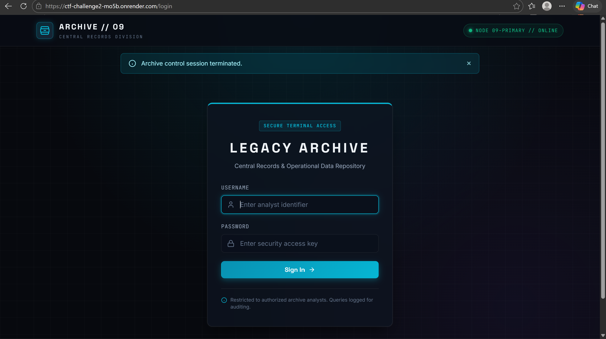
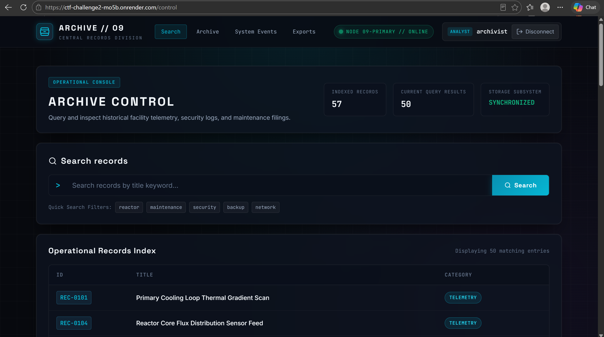
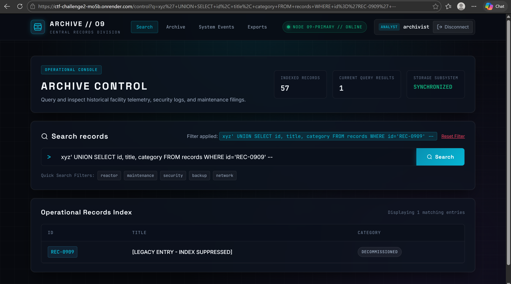
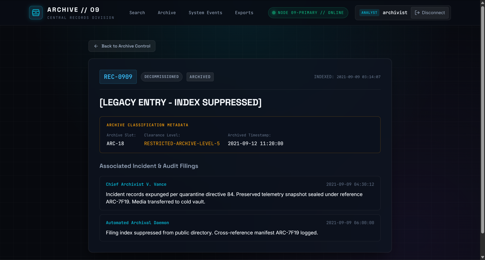
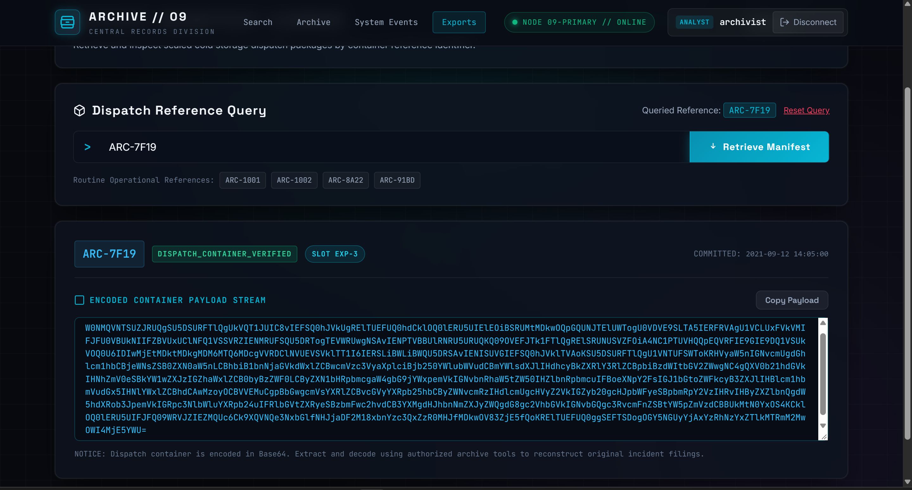
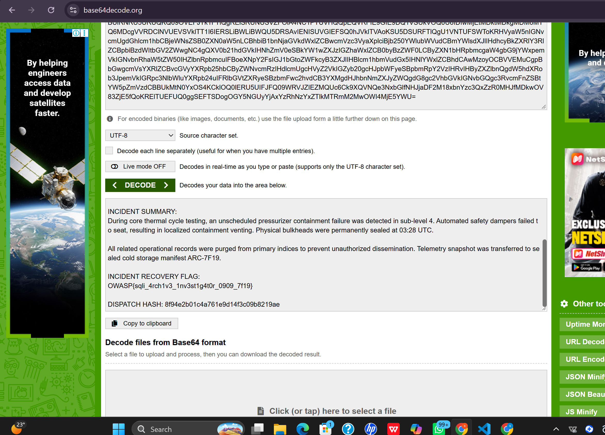

# ARCHIVE // 09 (Web, Hard)

**Author:** Shreya Gaikwad

**Category:** Web

**Difficulty:** Hard

## Challenge Description

> A legacy records archive contains thousands of operational records. Most records are harmless, but one archived incident was supposedly deleted years ago. The archive search system is still responding. You have been given access to an analyst account.
>
> Investigate the archive, identify the missing incident, and recover the final incident report.
>
> - **Flag format:** `OWASP{...}`
> - **Credentials provided:** `archivist` / `archive2026`
> - **Deployed at:** `https://ctf-challenge2-mo5b.onrender.com`

## Summary

A legacy records archive is hiding a supposedly deleted incident report. The attack chain is: log in with the given analyst account, find SQL injection in the record search, use a UNION query to reveal the suppressed incident record, follow its notes to a sealed export reference, and decode the export payload to recover the flag.

## Flag

```
OWASP{sqli_4rch1v3_1nv3st1g4t0r_0909_7f19}
```

---

## Step 1 — Log in and map the archive

Browsing to the deployed instance redirects to `/login` — a "LEGACY ARCHIVE / Secure Terminal Access" page.


*Login page — LEGACY ARCHIVE secure terminal access*

Logging in with the provided analyst credentials (`archivist` / `archive2026`) lands on the **Archive Control** dashboard: a record search interface showing 57 indexed records, with additional sections for Archive, System Events, and Exports.


*Archive Control dashboard after login — 57 indexed records*

A normal search (e.g. `Generator`) returns matching operational records, confirming the search backend works. But searching for `REC-0909` — an ID that never appears in any listing — returns zero results. Something was deliberately suppressed from the index.

## Step 2 — Confirm SQL injection in the search

Entering a single quote `'` in the search box returns a raw database error:

```
sqlite3.OperationalError: unrecognized token: ...
```

The search input is interpolated directly into a `LIKE '%INPUT%'` query with no sanitization or parameterization. The search endpoint is injectable.

## Step 3 — Reveal the suppressed record

With the injection confirmed, a UNION-based payload extracts the hidden record:

```
xyz' UNION SELECT id, title, category FROM records WHERE id='REC-0909' --
```


*UNION injection revealing the suppressed REC-0909 legacy entry*

This returns `REC-0909` — `[LEGACY ENTRY - INDEX SUPPRESSED]`, category `DECOMMISSIONED`, status `ARCHIVED`. The record was never deleted; it was only hidden from normal search results.

## Step 4 — Follow the evidence to ARC-7F19

The incident notes attached to `REC-0909` (Chief Archivist V. Vance) state that the incident records were expunged per quarantine directive 84, and the preserved telemetry snapshot was sealed under reference **ARC-7F19** and transferred to the cold vault. The same reference appears in the archive classification table as `RESTRICTED-ARCHIVE-LEVEL-5`.


*Incident notes for REC-0909 — sealed snapshot reference ARC-7F19*

## Step 5 — Pull the export manifest

The **Exports** section retrieves dispatch containers by reference — and it is injectable too, this time in a quoted equality context (`WHERE reference = 'INPUT'`). Requesting the reference directly works:

```
/export?reference=ARC-7F19
```

(An injection such as `' OR reference='ARC-7F19' --` achieves the same thing.) The manifest viewer returns the sealed container including a Base64-encoded payload.


*Export manifest viewer — ARC-7F19 with Base64-encoded payload*

## Step 6 — Decode the payload and read the flag

Base64-decoding the payload reveals the classified incident report: a pressurizer containment failure in sub-level 4, bulkheads permanently sealed, related records purged from primary indices — and at the bottom, the incident recovery flag:

```
OWASP{sqli_4rch1v3_1nv3st1g4t0r_0909_7f19}
```


*Decoded incident report — flag recovered*

## Solution Summary

| Field | Value |
|-------|-------|
| Challenge | ARCHIVE // 09 |
| Deployed at | https://ctf-challenge2-mo5b.onrender.com |
| Login (given in challenge) | `archivist` / `archive2026` |
| Suppressed record | `REC-0909` — [LEGACY ENTRY - INDEX SUPPRESSED] |
| Sealed export reference | `ARC-7F19` |
| Key payload | `xyz' UNION SELECT id, title, category FROM records WHERE id='REC-0909' --` |
| Flag | `OWASP{sqli_4rch1v3_1nv3st1g4t0r_0909_7f19}` |

## Root Cause

1. **SQL injection in two endpoints** — `/control` interpolates user input into a `LIKE '%INPUT%'` query and `/export` into a `WHERE reference = 'INPUT'` query, both built with raw string formatting instead of parameterized queries.
2. **Suppression instead of deletion** — `REC-0909` was hidden from the search index but left fully intact in the database, so any query path that bypasses the index filter (like UNION injection) recovers it completely.
3. **Sensitive data kept retrievable** — the full classified incident report, flag included, was stored as a Base64 payload in the exports table, one reference lookup away from disclosure.
4. **Verbose database errors** returned to the user confirmed injectability and aided payload tuning.

## Tools Used

- Browser — manual navigation, form input, URL parameter manipulation
- Base64 decoder — for the export manifest payload
- sqlite3 semantics knowledge — UNION-based extraction, `--` commenting

## Timeline

| Step | Action | Result |
|------|--------|--------|
| 1 | Log in as `archivist` / `archive2026` | Archive Control dashboard, 57 records |
| 2 | Search `Generator` | Matching records — search backend works |
| 3 | Search `REC-0909` | 0 results — record suppressed |
| 4 | Search `'` | `sqlite3.OperationalError` — SQLi confirmed |
| 5 | Search `xyz' UNION SELECT id, title, category FROM records WHERE id='REC-0909' --` | Suppressed legacy entry revealed |
| 6 | Read incident notes for REC-0909 | Reference `ARC-7F19` obtained |
| 7 | `/export?reference=ARC-7F19` | Sealed manifest with Base64 payload |
| 8 | Base64-decode payload | Incident report + flag captured |
