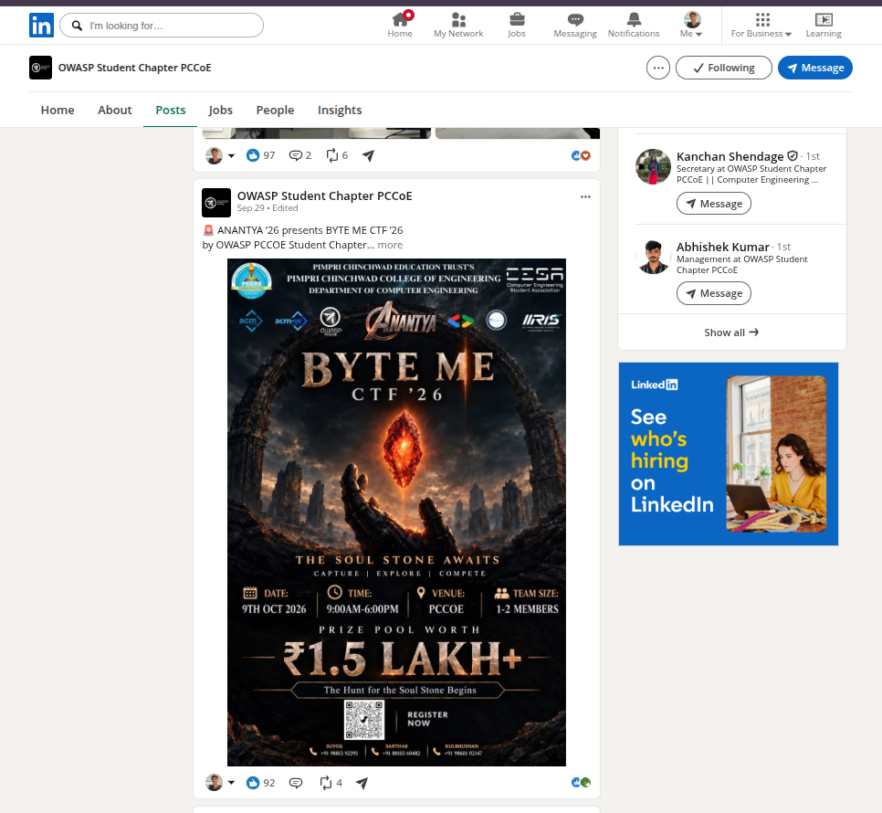
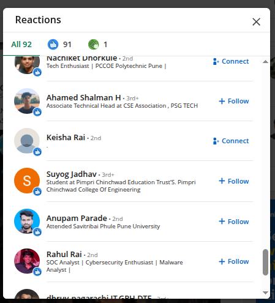
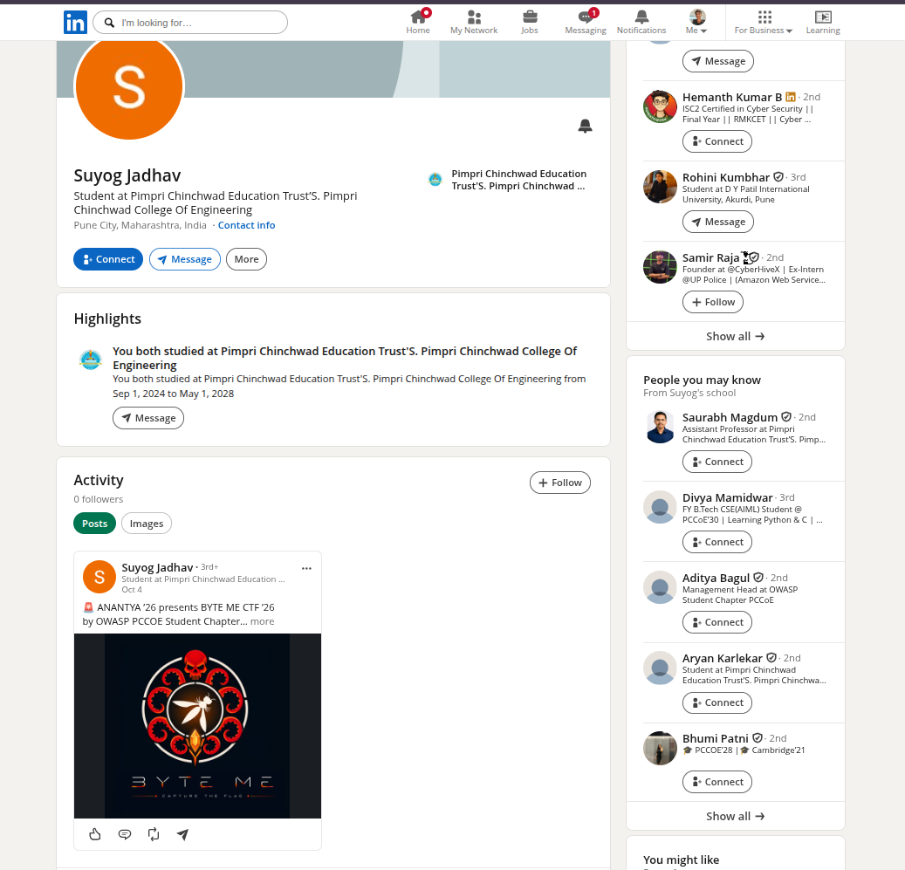
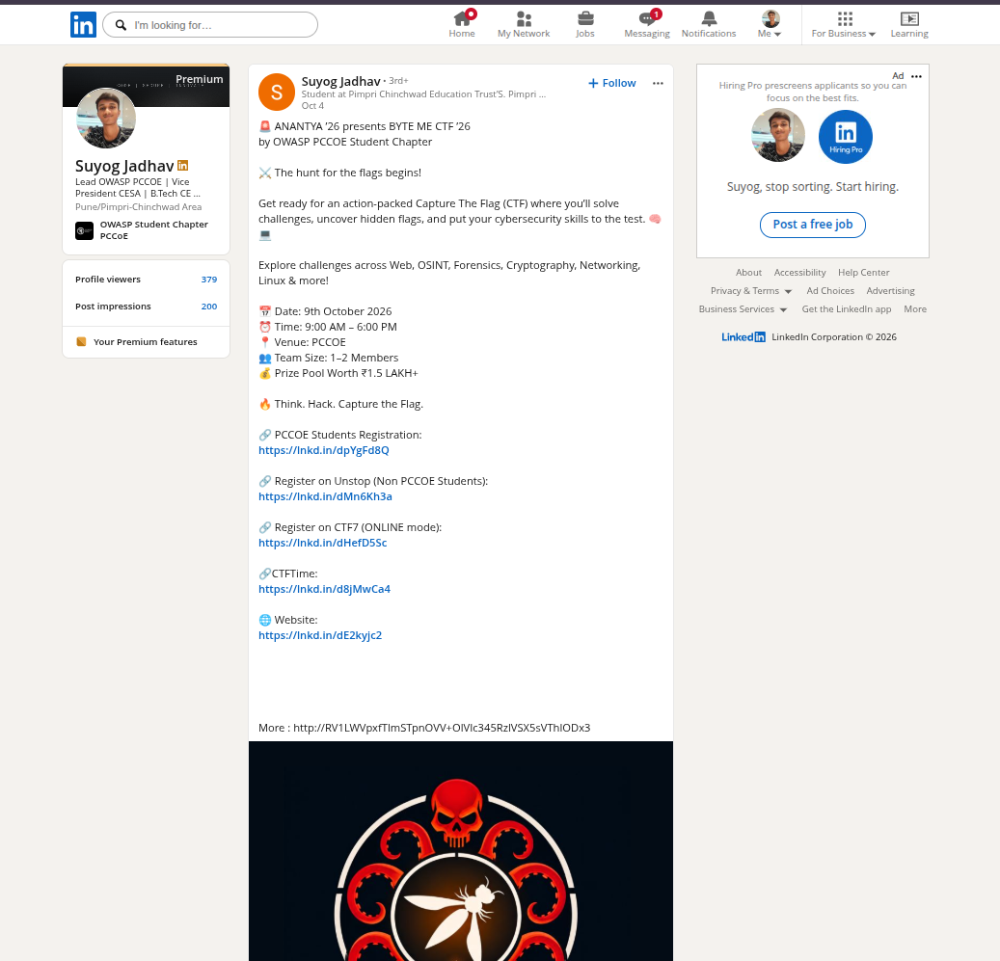
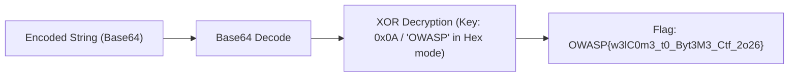
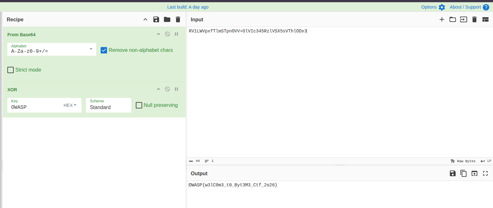

# Sanity Check (Misc / OSINT, Easy)

**Author:** Suyog Jadhav  
**Category:** Misc / OSINT  
**Difficulty:** Easy  
**Flag:** `OWASP{w3lC0m3_t0_Byt3M3_Ctf_2o26}`  

---

## 1. Challenge Description

> “Among the stones, one bears a false reflection.”  
>  
> The Soul Stone has left behind a trail, but not everything you find along the way can be trusted. An impostor walks among the echoes, wearing a familiar face and waiting for the careless seeker.  
>  
> **Your mission is simple:**  
> 1. Find the official presence of the challenge.  
> 2. Then, travel back to the very first announcement.  
>  
> But beware — one path is an illusion. The impostor has tried to mimic the true source. Only by identifying the genuine trail and reaching the first announcement will the Soul Stone reveal its secret.  
>  
> *Trust the source. Trace the beginning. Expose the impostor.*  
>  
> **Flag Format:** `OWASP{...}`

---

## 2. Summary

The Sanity Check challenge is an introductory OSINT and social-engineering reconnaissance challenge:
* **Target Presence:** The official LinkedIn page of **OWASP Student Chapter PCCoE**.
* **Pivot Point:** The very first announcement post for **BYTE ME CTF '26**.
* **Anomaly Detection:** An impostor account masquerading as author Suyog Jadhav left a reaction (like) on the official post.
* **Extraction:** Inspecting the impostor profile reveals a cloned post with a suspicious base64 payload hidden in the description text (`http://RV1LWVpxfTlmSTpnOVV+OlVIc345RzlVSX5sVThlODx3`).
* **Decoding:** Base64 decoding followed by single-byte XOR with key `0x0A` (or CyberChef hex key `OWASP`) reveals the flag.

---

## 3. Flag

```text
OWASP{w3lC0m3_t0_Byt3M3_Ctf_2o26}
```

---

## 4. Step-by-Step Breakdown

### Step 1 — Locating the Official Presence & First Announcement

Following the clue *"Find the official presence of the challenge. Then, travel back to the very first announcement"*, we navigate to the official LinkedIn organization page for **OWASP Student Chapter PCCoE**:



Scrolling down the timeline to the earliest announcement post reveals the original event flyer for **BYTE ME CTF '26**:
* **Theme:** *"The Soul Stone Awaits — Capture \| Explore \| Compete"*
* **Event Date:** 9th October 2026
* **Engagement:** 92 reactions

---

### Step 2 — Identifying the Impostor Account

The description cautions: *"An impostor walks among the echoes, wearing a familiar face and waiting for the careless seeker."*

We click on the post reactions list to inspect everyone who interacted with the announcement:



Among the list of 92 reactions, we spot an account named **Suyog Jadhav** with an orange avatar icon (`S`), distinct from the genuine author profile:
* **Account Name:** Suyog Jadhav
* **Headline:** Student at Pimpri Chinchwad Education Trust's Pimpri Chinchwad College Of Engineering
* **Discrepancy:** The profile is a newly created dummy account with 0 followers.

---

### Step 3 — Inspecting the Impostor's Activity

Visiting the impostor's LinkedIn profile page reveals a duplicate post mirroring the official CTF announcement:



The profile has zero connections and only a single published post dated October 4, mimicking the official promotional copy:
> *"ANANTYA '26 presents BYTE ME CTF '26 by OWASP PCCOE Student Chapter... more"*

---

### Step 4 — Extracting the Suspicious Payload

Clicking *"more"* to expand the full description of the cloned post reveals registration links and event details:



At the bottom of the description, an anomalous URL string is deliberately appended:

```text
More : http://RV1LWVpxfTlmSTpnOVV+OlVIc345RzlVSX5sVThlODx3
```

The path parameter `RV1LWVpxfTlmSTpnOVV+OlVIc345RzlVSX5sVThlODx3` is a 44-character Base64-encoded string.

---

### Step 5 — Decoding the Payload & Flag Recovery

We load the string into CyberChef or a Python script to decode the ciphertext:



In CyberChef:
1. **Recipe:** `From Base64`
2. **Recipe:** `XOR` (Key: `OWASP`, Scheme: `Standard`, Format: `HEX` $\rightarrow$ parses hex character `A` / `0x0A`)



The recovered output reveals the flag:

```text
OWASP{w3lC0m3_t0_Byt3M3_Ctf_2o26}
```

---

## 5. Automated Solver Script (`solve.py`)

A standalone Python solver performs the Base64 decode and XOR operations automatically:

```python
#!/usr/bin/env python3
"""
Sanity Check - Automated Solver
Author: Suyog Jadhav
Category: Misc / OSINT (Easy)
"""

import base64

def solve():
    # Encoded payload extracted from the impostor LinkedIn post description
    payload_b64 = "RV1LWVpxfTlmSTpnOVV+OlVIc345RzlVSX5sVThlODx3"
    
    print("[*] Decoding Base64 payload...")
    raw_bytes = base64.b64decode(payload_b64)
    
    print("[*] Applying XOR decryption with key 0x0A...")
    # CyberChef HEX key 'OWASP' parses valid hex digit 'A' (0x0A)
    xor_key = 0x0A
    flag = bytes([b ^ xor_key for b in raw_bytes]).decode("utf-8", errors="ignore")
    
    print(f"[+] Recovered Flag: {flag}")
    return flag

if __name__ == "__main__":
    solve()
```

### Running the Solver:

```bash
python3 solve.py
```

Output:
```text
[*] Decoding Base64 payload...
[*] Applying XOR decryption with key 0x0A...
[+] Recovered Flag: OWASP{w3lC0m3_t0_Byt3M3_Ctf_2o26}
```

---

## 6. Solution Summary

| Parameter | Specification |
|---|---|
| **Challenge** | Sanity Check |
| **Category** | Misc / OSINT |
| **Difficulty** | Easy |
| **Platform Investigated** | LinkedIn (OWASP Student Chapter PCCoE) |
| **Target Clue** | First announcement post reactions list |
| **Anomaly** | Impostor author account (`Suyog Jadhav`, 0 followers) |
| **Encoded Payload** | `RV1LWVpxfTlmSTpnOVV+OlVIc345RzlVSX5sVThlODx3` |
| **Cipher Scheme** | Base64 $\rightarrow$ XOR (`0x0A` / `OWASP` in Hex) |
| **Flag** | `OWASP{w3lC0m3_t0_Byt3M3_Ctf_2o26}` |

---

## 7. Methodology & Key Concepts

1. **Social Media Triage & Pivot Points:**  
   When challenge descriptions emphasize "official presence" and "first announcement", navigating to the oldest promotional post on the organizing committee's verified social channels provides the primary pivot.
2. **Anomaly Detection in Engagement Lists:**  
   Sock-puppet or clone accounts frequently reveal themselves through engagement lists (likes/shares). Key indicators include default/letter avatars, missing follower connections, and duplicate content.
3. **Encoding & Deobfuscation:**  
   URLs appearing in social media descriptions that do not resolve to domain names or endpoints often conceal encoded strings designed to be decrypted with challenge-specific keys.

---

## 8. Tools Used

* **Web Browser / Social Media:** LinkedIn
* **Online Decoding Suite:** CyberChef
* **Scripting:** Python 3 (`base64`)

---

## 9. Timeline

| Step | Action Taken | Result |
|:---:|---|---|
| 1 | Located official LinkedIn page (`OWASP Student Chapter PCCoE`) | Reached earliest BYTE ME CTF '26 post |
| 2 | Inspected 92 reactions on announcement post | Identified impostor account with orange avatar |
| 3 | Opened impostor profile and viewed cloned post | Found suspicious `http://RV1LWVpx...` link in description |
| 4 | Decoded string in CyberChef with Base64 + XOR | Recovered flag `OWASP{w3lC0m3_t0_Byt3M3_Ctf_2o26}` |